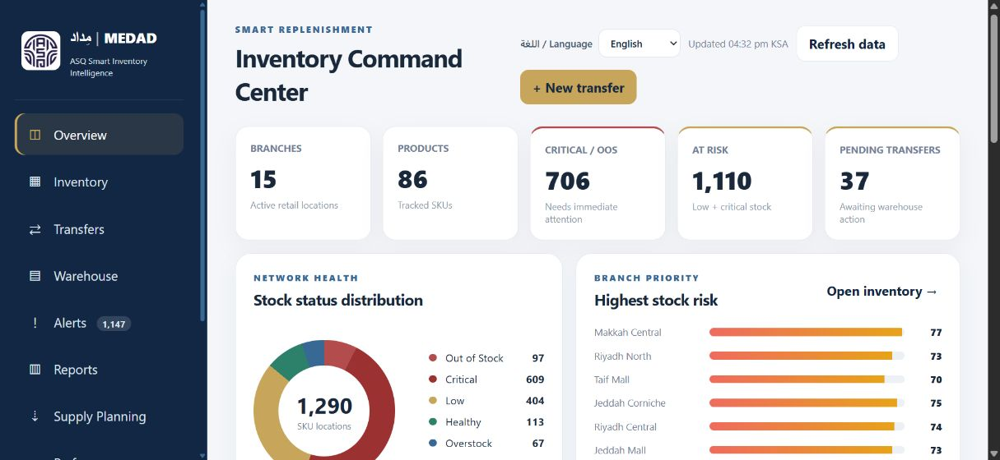
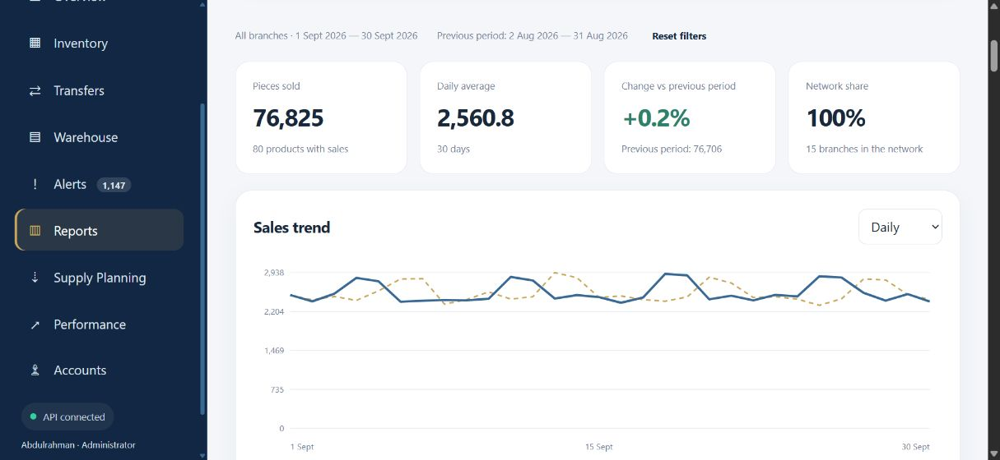
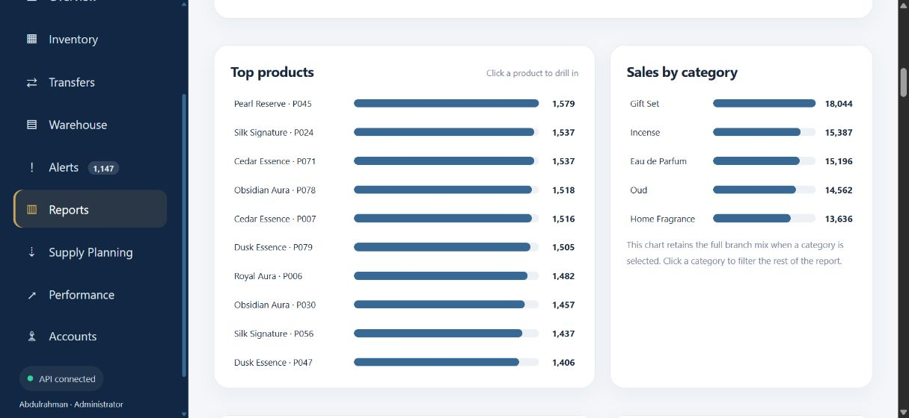
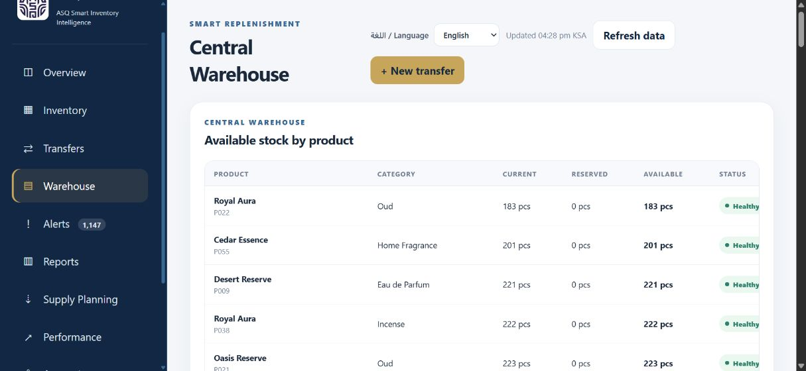
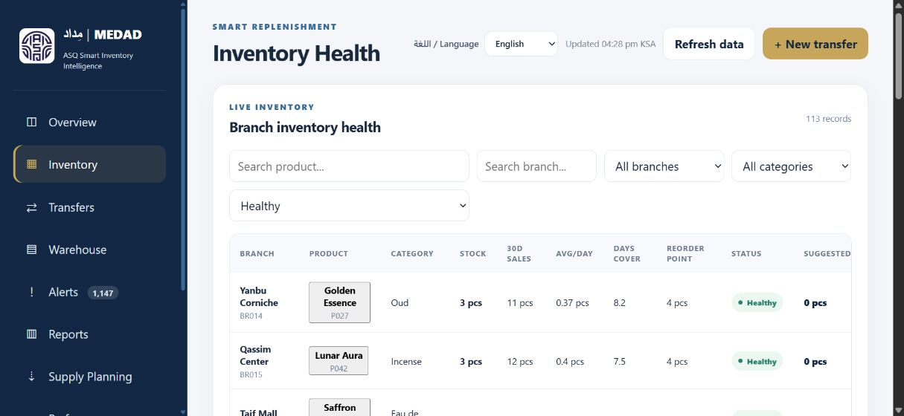
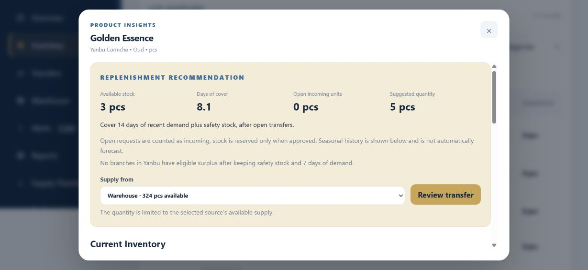
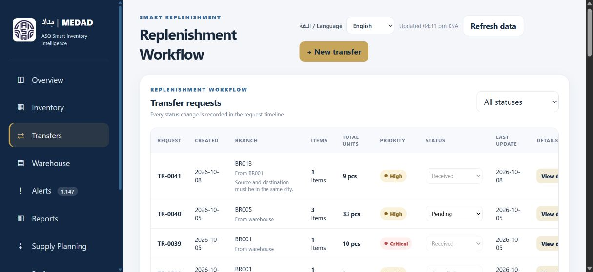

# مِداد | MEDAD

**ASQ Smart Inventory Intelligence**

A bilingual Arabic/English inventory operations application for monitoring branch stock, reviewing sales, balancing replenishment and tracking expected supply. Built with Node.js, Express, Supabase and a browser-based dashboard.

## Product tour

Screenshots show the running application after its data has loaded, using the project's demonstration dataset. Click any image to inspect it at full size.

### Overview

Branch and product counts, stock-risk indicators, open transfers and network health.



### Sales reports

Monthly-period sales totals, daily averages and comparison with the previous period.



### Product and category analysis

Interactive rankings of the strongest products and category sales mix.



### Central warehouse

Current, reserved and available balances by product.



### Branch inventory

Stock on hand, recent sales, stock cover and replenishment indicators. This example filters to healthy stock.



### Product Insights

Available stock, days of cover, open incoming quantities and a reviewable replenishment recommendation.



### Transfer movements

Multi-product transfer quantities, priorities and workflow states from the request register.



## Features

- Branch inventory health, warehouse stock, low-stock alerts and product search.
- Product Insights with recent sales, seasonal comparisons, stock cover and replenishment recommendations.
- Multi-product warehouse replenishment and same-city branch transfers with approval, shipment and receipt states.
- Interactive sales reports with branch, category, product and date filters, plus daily/weekly/monthly charts.
- Piece and weighted products with exact 0.01 g precision. Ounce = 30 g; half ounce = 15 g; quarter ounce = 7.50 g. Wood priced at SAR 1,500 per ounce or above allows quarter-ounce packages. Wholesale package information includes 125 g and 1,000 g.
- Supply needs and expected arrivals: requested/confirmed/in-transit/arrived/cancelled states, partial arrivals, ERP references, due dates, action history and CSV export.
- Local role-based accounts, protected server APIs, Arabic/English navigation and blue/gold branding.

The intelligence currently consists of explicit sales and inventory calculation rules. No trained machine-learning model or LLM integration is included.

## Run locally

Use a supported Node.js runtime, npm, and a compatible Supabase database.

```bat
npm ci
copy .env.example .env
```

Set your own Supabase project URL and **server-side** service-role key in `.env`, then run:

```bat
npm start
```

Open **http://localhost:3003**. On a fresh installation, create the administrator through the setup form. There is no default account or password.

Keep `.env` on the server. Do not put Supabase secret keys in browser code, GitHub, screenshots or client requests. The optional `RETAILFLOW_HOST` setting defaults to local access; hosting and remote access require a separate deployment configuration.

## Database requirements

This source snapshot was built against an existing RetailFlow-compatible Supabase schema, including products, branches, sales, branch/warehouse inventory and transfer tables/views. **A complete base-schema bootstrap and production database export are not included.** Pointing it at an empty Supabase project is insufficient.

The additive SQL in this repository is applied only after that compatible base schema exists:

- `sql/operations.sql`: protected transfer operations and source-coverage settings.
- `sql/weighted-products.sql`: weighted-product metadata and optional, clearly labelled demo seeding.

Read and review migrations against your database before running them. Weighted products store quantities internally as integer centigrams (`quantity_scale=100`); the application API displays grams. Existing piece products remain integers. Do not interpret weighted database quantities as pieces.

Optional demo seeding, after migrations and with the server stopped:

```bat
node scripts/seed-weight-demo.cjs . --check
node scripts/seed-weight-demo.cjs . --seed --port=3003
```

The six demo weighted products and their generated sales are fictitious. Demo records are not a representation of real ASQ operations.

## Supply planning and ERP scope

Supply planning is a manual tracking workflow. Saving a request does not send it to an ERP, factory or supplier. Confirmed incoming quantities require a manually recorded confirmation reference and expected date. Unconfirmed requests are not treated as committed incoming stock.

Recording arrival updates the supply tracking record; it **does not post warehouse stock**. Coordinate physical receipt and inventory updates through the established warehouse/ERP process. There is no direct ERP integration, manufacturing execution or raw-material planning in this version.

## Local data and roles

Accounts, audit history and supply requests are stored in the local `data/` directory, outside `public/`. This directory is excluded from Git. Back it up securely and retain it across application restarts. Sessions are held in memory, so restarting the server requires signing in again.

Supply request writes use atomic replacement, an exclusive file lock and version checks. The local store is intended for a single server, not a distributed multi-server deployment. After a crash, investigate any stale lock with the server stopped before removing it; do not discard request data.

- **Administrator:** account administration and central operations.
- **Approver:** warehouse-transfer approvals and supply confirmations.
- **Warehouse:** shipping operations and supply arrival tracking.
- **Branch manager:** assigned-branch transfer operations; no central supply page.
- **Viewer:** read-only operational access.

Server routes enforce permissions; hiding a button is not the access-control mechanism. Branch-to-branch operations are restricted to administrators and same-city routes.

## Tests

```bat
npm test
```

Tests cover replenishment rules, report calculations, weight precision/package rules and supply request validation, partial arrivals and local persistence. Live database credentials are not required for these tests.

## Repository contents

`public/` contains the browser interface; `lib/` contains authentication and operational modules; `sql/` contains additive migrations; `scripts/` contains the optional weighted demo helper; `tests/` contains rule and persistence tests.

The repository excludes `.env`, local accounts, audit logs, real supply requests, dependency folders and backups. This is source code for a server application, not a GitHub Pages deployment. Brand assets remain the property of their respective owner; no third-party trademark rights are granted by this repository.
